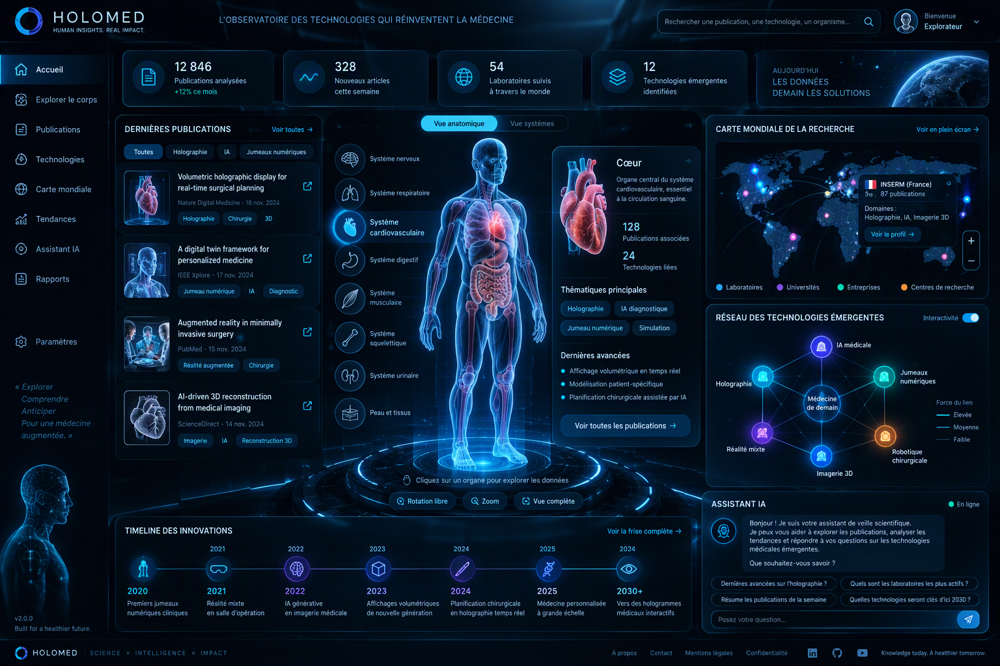

<p align="center">
  
</p>

<h1 align="center">HOLOMED</h1>

<p align="center">
  Exploring the Technologies Shaping the Future of Medicine
</p>

<p align="center">
  
  
  
</p>

HOLOMED is an automated scientific intelligence platform that collects, analyzes and centralizes publications related to holographic medicine, digital twins, AI-powered healthcare and immersive technologies in order to identify the innovations shaping the future of medicine.

---

## Objectives

- Monitor emerging medical technologies.
- Aggregate trusted scientific publications.
- Identify long-term innovation trends.
- Provide accessible scientific intelligence.
- Build an open knowledge platform.

---

## Project Status

HOLOMED is currently in the design and architecture phase.

### Current Focus

- Governance
- Data management policies
- Technical architecture
- Source definition

Development of the collection pipeline and web platform will begin in the next phase.

---

## Key Features

- Automated scientific publication monitoring
- AI-powered summarization
- Medical technology trend analysis
- Global research ecosystem mapping
- Interactive visualization dashboards
- Medical innovation knowledge base
- Future AI-powered research assistant

---

## Platform Preview

<p align="center">
  
</p>

---

## Architecture

```text
                       Sources
                           │
                           ▼
                     n8n Workflows
                           │
          ┌────────────────┼────────────────┐
          ▼                ▼                ▼
   AI Processing    Deduplication    Classification
          │                │                │
          └────────────────┴────────────────┘
                           │
                           ▼
                     PostgreSQL
                           │
         ┌─────────────────┼─────────────────┐
         ▼                 ▼                 ▼
      Website           Discord          GitHub
```

---

## Planned Technology Stack

### Frontend

- Next.js
- TypeScript
- Tailwind CSS
- Three.js

### Backend

- Node.js
- PostgreSQL

### Automation

- n8n

### Artificial Intelligence

- OpenAI
- Ollama

### Infrastructure

- Docker

---

## Monitored Sources

### Scientific Sources

- PubMed
- IEEE Xplore
- Nature
- Springer
- ScienceDirect
- arXiv

### Research Organizations

- Microsoft Research
- NVIDIA Research
- INSERM
- CNRS
- NIH

---

## Governance & Standards

HOLOMED follows a governance-first approach to ensure data quality, traceability and long-term maintainability.

### Git Workflow

The project uses the following branching strategy:

```text
main
└── Production-ready code

develop
└── Integration branch

feature/*
└── New feature development

bugfix/*
└── Bug fixes

hotfix/*
└── Critical production fixes
```

### Branch Protection

The following rules apply:

- Pull Requests are required before merging into `main`
- Force pushes are prohibited
- Branch deletion is restricted
- Linear Git history is enforced
- Changes are tracked through Git history and Pull Requests

### Data Governance

HOLOMED applies strict governance rules for data collection, processing and visualization.

#### Data Collection

Approved sources currently include:

- PubMed
- IEEE Xplore
- Nature
- Springer
- ScienceDirect
- arXiv
- Microsoft Research
- NVIDIA Research
- INSERM
- CNRS
- NIH

All collected publications must contain:

- Title
- Authors
- Source
- Publication Date
- Collection Date
- URL
- Category
- Keywords

#### Source Management

Sources can be added or removed through documented Pull Requests.

Requirements for new sources:

- Scientific or institutional credibility
- Publicly available data
- Relevance to HOLOMED domains
- Compliance with usage and licensing terms

Historical records remain preserved even when a source is retired.

#### Duplicate Management

HOLOMED applies multiple duplicate detection mechanisms.

##### High Confidence Identifiers

- DOI
- PMID
- arXiv Identifier
- URL

##### Additional Verification

- Exact title match
- Same publication date
- Title similarity ≥ 95%
- Author consistency

When duplicates are detected:

1. The most complete record is retained.
2. Metadata may be merged.
3. Source traceability is preserved.
4. Detection events are logged.

### Data Processing

Standard processing pipeline:

```text
Collection
→ Validation
→ Deduplication
→ Classification
→ AI Enrichment
→ Storage
→ Visualization
```

The platform follows an "Insert Only" philosophy:

- Data is added
- Data is archived
- Historical records are preserved

### Data Visualization Principles

Visualizations must:

- Answer a specific research question
- Display data source information
- Display the observation period
- Display the last update date
- Remain reproducible and understandable

Supported visualization types:

- Timelines
- Network Graphs
- World Maps
- Bar Charts
- Treemaps
- Trend Analysis Dashboards

---

## Architecture Decision Records (ADR)

Major architectural decisions are documented through Architecture Decision Records (ADR).

These documents provide traceability and explain the rationale behind key technical and organizational decisions.

```text
docs/adr/
├── ADR-001-project-architecture.md
├── ADR-002-git-workflow.md
├── ADR-003-license-choice.md
└── ADR-004-data-governance.md
```

Current ADRs document:

- Project architecture decisions
- Git workflow and branching strategy
- License selection
- Data governance principles

Future ADRs will be added as the project evolves.

---

## Roadmap

### Phase 1 - Governance

- [x] Repository setup
- [x] Branch strategy
- [x] Data governance
- [x] Documentation

### Phase 2 - Data Collection

- [ ] Source connectors
- [ ] n8n workflows
- [ ] Deduplication engine

### Phase 3 - Data Platform

- [ ] PostgreSQL database
- [ ] APIs
- [ ] Knowledge base

### Phase 4 - User Interface

- [ ] Dashboard
- [ ] World map
- [ ] Visual analytics

### Phase 5 - AI Layer

- [ ] Scientific summarization
- [ ] Trend analysis
- [ ] Conversational assistant

---

## Contributing

Suggestions, feedback and reliable scientific sources are welcome.

Before opening an Issue or Pull Request, please read:

```text
docs/governance/contribution-guidelines.md
```

---

## Project Documentation

```text
docs/
├── planning.md
├── projet_Holomed.md
│
├── adr/
│   ├── ADR-001-project-architecture.md
│   ├── ADR-002-git-workflow.md
│   ├── ADR-003-license-choice.md
│   └── ADR-004-data-governance.md
│
└── governance/
    ├── git-workflow.md
    ├── contribution-guidelines.md
    ├── data-collection-policy.md
    ├── data-processing-policy.md
    └── data-visualization-policy.md
```

This documentation provides project governance, planning, architecture decisions and data management standards.

---

## License

GPL-3.0
